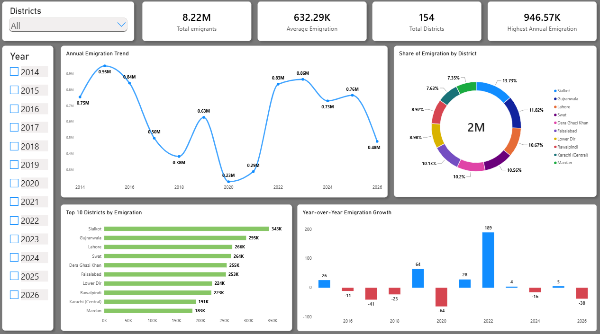
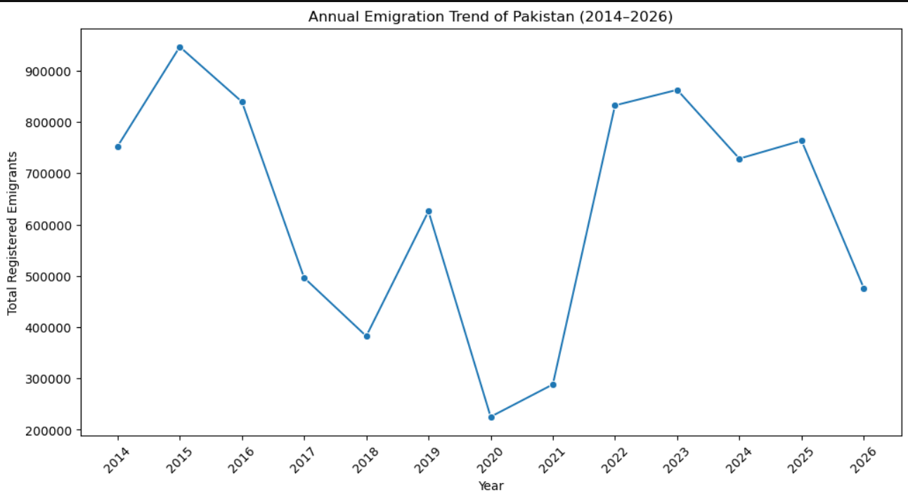
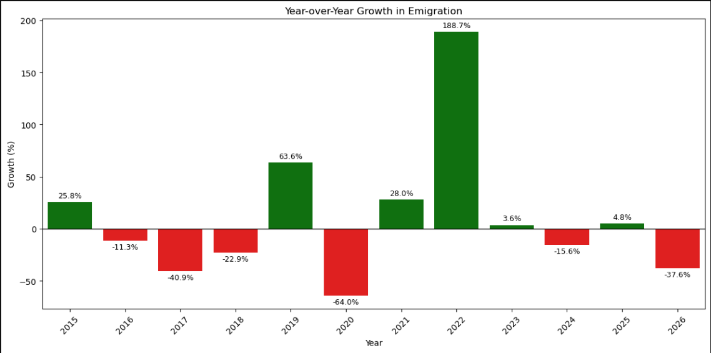
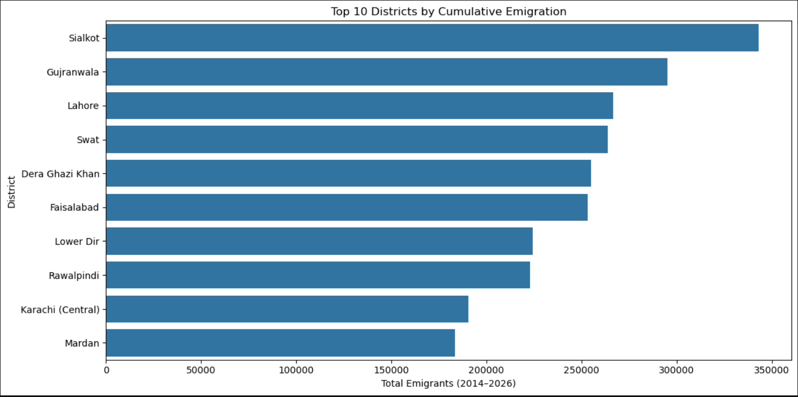
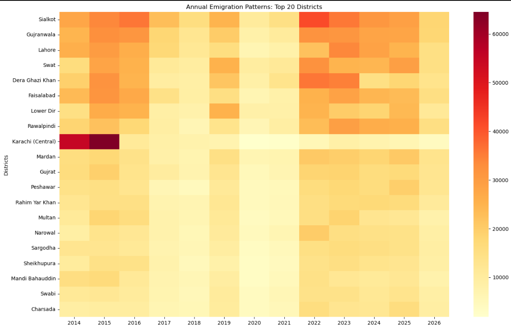
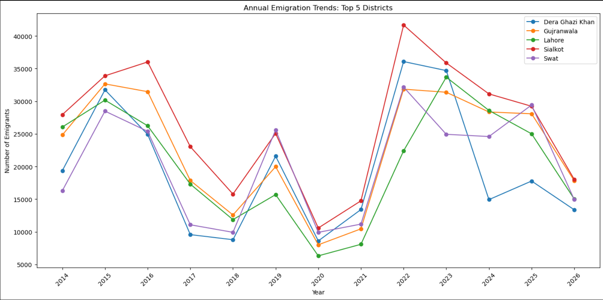
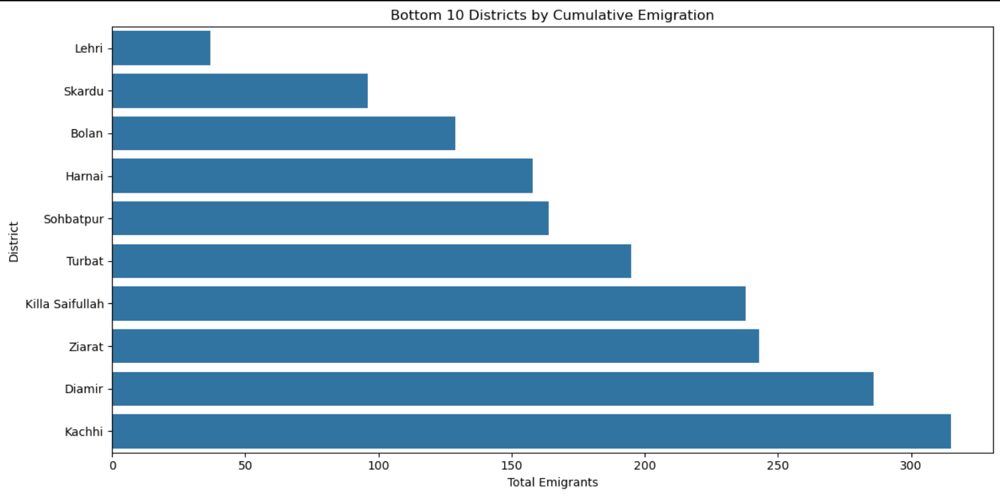
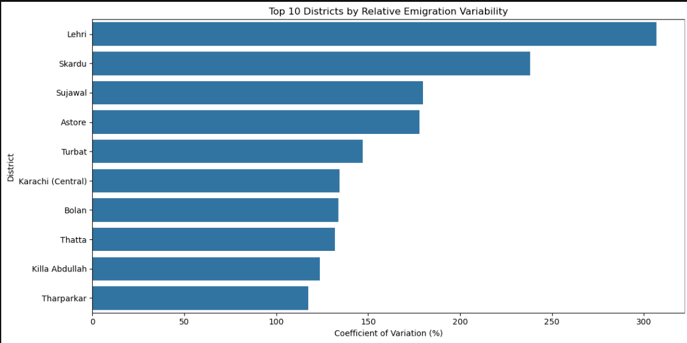
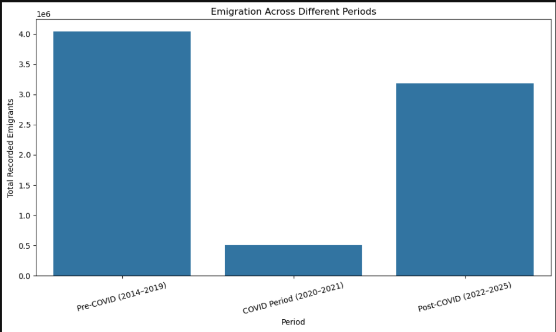
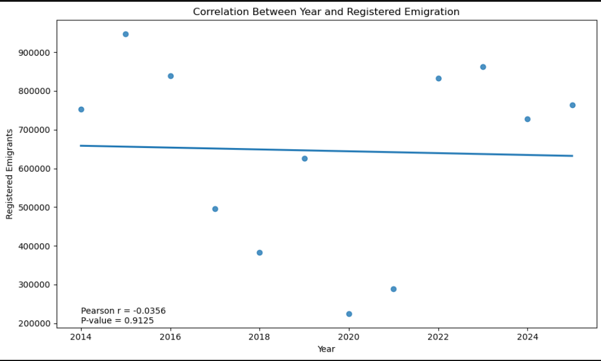

# Emigration-Analysis-of-Pakistan (2014–2026)

An end-to-end data analytics project on **registered overseas emigration from 154 Pakistani districts**, using data published by the **Bureau of Emigration & Overseas Employment (BEOE), Pakistan**. The project covers data cleaning, exploratory analysis, statistical analysis, SQL querying and an interactive Power BI dashboard.



## Key Results

| Question | Answer |
|---|---|
| How many registered emigrants in 2014–2025? | **7,743,483** (8.22M including partial 2026) |
| Peak year / lowest year | **2015** (946,571) / **2020** (225,213) |
| Impact of COVID-19 (2020) | **-64.0%** vs 2019 |
| Biggest rebound | **+188.7%** in 2022 (832,339) |
| Overall trend | Essentially flat: 752,466 in 2014 vs 763,526 in 2025 (+1.5%) |
| Top district (cumulative) | **Sialkot** – 342,969 (4.2% of the national total) |
| Concentration | The top 10 districts (6.5% of districts) account for about **30%** of all registrations |
| Distribution | Strongly right-skewed: district mean 50,282 vs median 27,344 |

> **Note on 2026:** the dataset includes a 2026 column that is a partial year. It is excluded from the statistical analysis and SQL year comparisons (2014–2025), but still appears in the EDA charts and the dashboard. See [Methodology Notes](#methodology-notes).

## Objectives

- Analyze annual overseas emigration trends in Pakistan.
- Identify the districts with the highest and lowest emigration.
- Measure year-over-year changes and growth rates.
- Find districts with consistently high or highly volatile emigration.
- Compare emigration before, during and after the COVID-19 period.
- Communicate the findings through an interactive dashboard.

## Dataset

**Source:** Bureau of Emigration & Overseas Employment (BEOE), Pakistan.

| Attribute | Description |
|---|---|
| `Districts` | District name (154 unique districts) |
| `2014` – `2025` | Registered emigrants per year |
| `2026` | Partial-year figures |
| `Total` | Cumulative figure in the source file (2014–2026) |

All 154 rows have no missing values and no duplicates. Some districts have very small counts (the smallest cumulative total is **37**, for Lehri), and a number of district-years are recorded as 0.

## Tools

| Tool | Purpose |
|---|---|
| Microsoft Excel | Initial cleaning of the raw file |
| Python (Pandas, NumPy) | Cleaning, validation, analysis |
| Matplotlib, Seaborn | Visualization |
| SciPy | Confidence interval and Pearson correlation |
| MySQL 8.0+ | SQL analysis (CTEs, window functions) |
| Power BI | Interactive dashboard |
| Jupyter Notebook | Python workflow |

## Project Workflow

### 1. Data Cleaning – `1_Data_Cleaning.ipynb`

Most cleaning was done in Excel; the notebook documents the validation in Python:

- Loaded the raw CSV (`latin-1` encoding): **154 rows × 15 columns**.
- Found **14 district names** with leading or trailing spaces (16 extra characters in total) and trimmed them.
- Confirmed **0 missing values** and **0 duplicate rows**, with all 154 district names unique.
- Checked data types (district names as text, all year columns and `Total` as integers).
- Exported the cleaned file for the later notebooks.

### 2. Exploratory Data Analysis – `2_Exploratory_Data_Analysis__EDA_.ipynb`

- National annual trend and year-over-year growth.
- Top 10 and bottom 10 districts by cumulative emigration.
- Top-5 district trends, district share of the national total and a top-20 heatmap.
- Distribution, skewness, kurtosis and IQR outlier detection.
- Pre-COVID, COVID and post-COVID comparison.

### 3. Statistical Analysis – `3_Statistical_Analysis.ipynb`

All figures below use district totals for **2014–2025**.

| Statistic | Result |
|---|---:|
| Mean district total | 50,282 |
| Median district total | 27,344 |
| Standard deviation | 63,720 |
| Minimum / Maximum | 37 / 324,939 |
| Skewness | 1.918 |
| Excess kurtosis | 3.925 |
| Mean / median annual growth | 14.54% / 3.64% |
| Growth standard deviation | 67.45% |

- **District variability:** the coefficient of variation (CV) was calculated for every district.
- **Correlation:** Pearson correlation between year and national annual emigration gave **r = -0.0356, p = 0.9125** (n = 12), meaning no significant linear trend over time. The series rises and falls rather than moving in one direction, so a linear test is of limited use here.
- **Outliers (IQR method):** eight districts are statistical outliers on the high side: Sialkot, Gujranwala, Lahore, Swat, Dera Ghazi Khan, Faisalabad, Lower Dir and Rawalpindi.

### 4. SQL Analysis – `Emigration_Project.sql`

The cleaned data was loaded into MySQL. Techniques: CTEs, `UNION ALL` to unpivot year columns, `LAG()`, `RANK()` / `DENSE_RANK()`, `CASE`, self-joins and subqueries.

The file contains 13 analyses:

1. Top 10 districts by total emigration
2. Annual totals and growth rates
3. Highest and lowest emigration years
4. District ranking by cumulative emigration (2014–2025)
5. Top five districts for each year
6. District-wise year-over-year change
7. Frequency of top-five appearances
8. Ranking by average annual emigration
9. Highest percentage growth between consecutive years
10. Largest absolute increases
11. Largest annual declines
12. Pre-COVID vs COVID vs post-COVID comparison
13. Percentage change between periods

**Selected findings**

- Sialkot ranked first by average annual emigration (about **27,078 per year**), followed by Gujranwala (about 23,121).
- Sialkot and Gujranwala appeared in the annual top five in all 12 years; Swat appeared nine times.
- Sialkot recorded the largest annual increase: **+26,929 in 2022** (14,743 to 41,672). Eight of the ten largest district-level increases occurred in 2022.
- Karachi (Central) recorded the largest annual decline: **-53,458 in 2016**.

### 5. Power BI Dashboard

The dashboard shows four KPI cards (total emigrants, average annual emigration, number of districts, highest annual emigration), a district dropdown, a year slicer, the annual trend, the top 10 districts, a share-of-emigration donut chart for those top 10 districts, and year-over-year growth.


## Visual Highlights

### Annual trend and year-over-year growth





### Leading districts







### Smallest and most volatile districts





### COVID-19 comparison and correlation





## COVID-19 Period Comparison

The conclusion depends on which years are used as the pre-COVID baseline, so both versions are reported:

| Baseline (pre-COVID) | Pre-COVID avg/year | COVID avg/year (2020–21) | Post-COVID avg/year (2022–25) | COVID change | Post-COVID change |
|---|---:|---:|---:|---:|---:|
| 2014–2019 (Python notebooks) | 673,832 | 256,747 | 796,750 | **-61.9%** | **+18.2%** |
| 2017–2019 (SQL file) | 501,534 | 256,747 | 796,750 | **-48.8%** | **+58.9%** |

Registrations dropped sharply in 2020 and recovered strongly from 2022. Whether recent years look only modestly above or far above "normal" depends on the baseline chosen. The 2014–2016 years were unusually high, partly because of a single district (see below).

## Key Findings

- **Strong geographic concentration.** Sialkot, Gujranwala, Lahore, Swat, Dera Ghazi Khan and Faisalabad lead the country, and eight districts are statistical outliers on the high side.
- **No long-run growth.** Annual registrations in 2025 are about the same as in 2014 and 19% below the 2015 peak; the story is volatility, not a steady rise.
- **COVID shock and 2022 rebound.** Registrations fell 64% in 2020 and nearly tripled in 2022.
- **Sialkot is both the largest and one of the most stable large districts**, with a CV of about 35%.
- **Karachi (Central) distorts the early years.** Its heatmap row is far above every other district in 2014–2015 and then collapses, which makes it one of the most volatile districts (CV about 134%) despite a high cumulative total.
- **Small districts dominate the volatility ranking.** Lehri, Skardu, Sujawal, Astore and Turbat have the highest CVs, but their average annual counts are very small, so percentage swings there reflect tiny numbers.

## Methodology Notes

- **Time window.** The statistical notebook and SQL year-by-year queries use **2014–2025**. The EDA notebook and the dashboard include **2026**, which is a partial year, so the 2026 drop (-37.6%) should not be read as a real decline. Rankings based on the source `Total` column (EDA top 10, dashboard) include 2026.
- **Dashboard donut.** The shares shown (for example Sialkot 13.73%) are relative to the **top 10 districts only**. Sialkot's share of the national total is **4.17%**.
- **Dashboard average.** "Average Emigration" (632.29K) is the average national total per year across 2014–2026, including the partial 2026.
- **District names.** Cleaning removed extra spaces only. Source spellings such as *Bahwalnagar*, *Bahwalpur* and *Bhakar* were kept as published.

## Limitations

- The data covers **registered** emigration through BEOE and does not represent all overseas migration.
- The data cannot explain *why* emigration changed. COVID-19 is one plausible driver of the 2020 drop, not a proven cause.
- District boundaries and names changed over time, so some changes (for example the Karachi (Central) fall after 2015) may partly reflect administrative changes.
- District counts are not adjusted for population, so large districts naturally record higher numbers.
- A correlation of year with annual emigration over 12 data points has little statistical power.

## Repository Structure

```text
Pakistan-District-Wise-Emigration-Analysis/
├── Data/
│   ├── Emigration_district.csv
│   └── Emigraion_Cleaned.csv
├── Notebooks/
│   ├── 1_Data_Cleaning.ipynb
│   ├── 2_Exploratory_Data_Analysis__EDA_.ipynb
│   └── 3_Statistical_Analysis.ipynb
├── SQL/
│   └── Emigration_Project.sql
├── Images/
│   └── (charts and dashboard screenshots)
└── README.md
```

## How to Reproduce

1. Install the Python libraries: `pip install pandas numpy matplotlib seaborn scipy wordcloud jupyter`.
2. Place the raw CSV in `Data/` and update the file paths at the top of each notebook (they currently point to a local Windows folder).
3. Run the notebooks in order: 1 (cleaning), then 2 (EDA), then 3 (statistics).
4. For SQL, import the cleaned CSV into MySQL 8.0 or later as a table named `emigration`, then run `SQL/Emigration_Project.sql`.

## Conclusion

Registered emigration from Pakistan is concentrated in a small group of districts, has been volatile rather than steadily rising, and was reshaped by a sharp COVID-19 drop followed by a strong 2022 rebound. The project demonstrates a complete workflow, from raw data to dashboard, using Excel, Python, MySQL and Power BI.

---

**Data source:** Bureau of Emigration & Overseas Employment (BEOE), Pakistan
